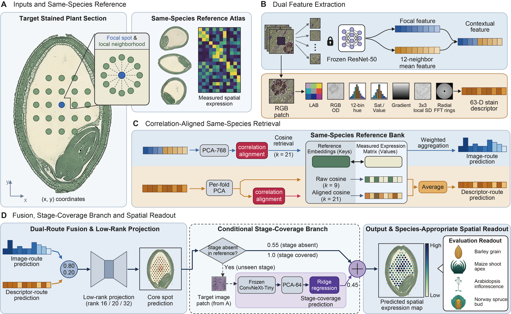

# PlantLumen

**Reference-assisted image-to-expression prediction for plant tissue sections**

Jinjin Huang<sup>1</sup>, Lingling Zheng<sup>1,\*</sup>

<sup>1</sup> MOE Key Laboratory of Gene Function and Regulation, State Key Laboratory for Biocontrol,
Innovation Center for Evolutionary Synthetic Biology, School of Life Sciences / School of Agriculture
and Biotechnology, Sun Yat-sen University Shenzhen Campus, Shenzhen 518107, China.

<sup>\*</sup> Correspondence: Lingling Zheng
([zhengll33@mail.sysu.edu.cn](mailto:zhengll33@mail.sysu.edu.cn))

PlantLumen predicts spatial gene expression from routine plant tissue sections using a same-species
expression reference. It describes each capture location with frozen ImageNet features, the mean of
its 12 nearest physical neighbours and a 63-dimensional plant stain descriptor, retrieves profiled
reference spots explicitly, and projects the retrieved profiles onto a low-rank expression subspace.
The chain is fitted independently within each species and each held-out fold; no weight, reference
bank or gene panel is shared across species.

## Abstract

Spatial transcriptomics resolves gene expression across tissue architectures, yet high experimental
costs leave many plant samples with only stained histological sections, and no computational
framework dedicated to predicting spatial gene expression from plant tissue sections yet exists.
Here, we present PlantLumen, the first computational framework tailored to plant tissue sections
that combines visual features, physical neighborhood context, and a plant stain descriptor with
reference profiles from the same species to predict spatial gene expression across sections. Using
spatial transcriptomic profiles from developing barley grains, we show that PlantLumen outperforms
the strongest animal-pathology baseline model in predicting spatial gene expression by 43% across
unseen sections and reliably recovers spatial expression patterns of stage-enriched and core
metabolic pathway genes even when entire developmental stages are withheld. In addition, PlantLumen
enabled us to quantify prior image predictability for each gene before model fitting to identify
spatially recoverable genes, and to generalize across maize shoot apices, *Arabidopsis*
inflorescences, and Norway spruce buds, accurately resolving cell-type domains in spruce and mapping
cone-identity regulators in unseen mutants from wild-type reference sections alone. This approach
paves the way for transforming routine stained plant sections into spatial gene expression maps
across diverse organs, developmental stages, and genotypes.

## Reported Results

These are the values reported in the current manuscript. The repository ships the cohort-level
summary tables under `artefacts/summary/`; the full U1 four-cohort analysis pipeline is being
consolidated into the package (see **Current release scope**).

- **Barley.** Mean per-gene spatial correlation 0.1350, against 0.0944 for the strongest comparator
  mclSTExp, with a lead on all nine held-out sections (paired Wilcoxon P = 0.0039).
- **Maize.** Mean spatial correlation 0.6058 across seven held-out sections, against 0.5721 for
  ST-Net, with a lead on six of seven sections (P = 0.031).
- **Arabidopsis.** Mean spatial block correlation 0.1726, the highest of the five baselines run on
  the cohort.
- **Norway spruce.** Mean per-spot correlation 0.1312 over 3,123 shared genes, against 0.1148 for
  mclSTExp.
- **Image predictability.** Per-gene image R² orders held-out gene recovery at Spearman ρ = 0.805 in
  spruce and ρ = 0.635 in maize.
- **Wild-type-only reference.** A reference bank built from 19 wild-type shoots predicts all 28
  *acrocona* sections positively (mean r = 0.117).

## Workflow



**Fig. 1 overview.** PlantLumen represents each capture location with a frozen ImageNet ResNet-50
focal patch feature, the mean of its 12 nearest physical neighbours and a 63-dimensional plant stain,
colour and texture descriptor. The image route applies PCA-768 and correlation alignment before
cosine retrieval (k = 21); the descriptor route applies per-fold PCA and averages raw (k = 9) and
aligned (k = 21) retrieval. The two predictions are fused at fixed 0.80/0.20 weights and projected
onto low-rank subspaces (ranks 16, 20 and 32). A conditional stage-coverage branch contributes at
0.55/0.45 only when the held-out developmental stage is absent, and the output is evaluated across
barley, maize, Arabidopsis and Norway spruce at species-appropriate readouts.

## Highlights

- **Frozen retrieval chain.** No end-to-end training and no cross-species parameter sharing; PCA,
  covariance alignment, the reference bank and the expression subspace are fitted inside one species
  and one held-out fold.
- **Plant-specific representation.** A 63-dimensional stain, colour and texture descriptor gives the
  retrieval a second route that ImageNet features do not provide.
- **Physical-neighbour context.** Each spot is described together with its 12 nearest physical
  neighbours, which matters when a 55 μm spot contains less than one cell equivalent.
- **Explicit and inspectable retrieval.** Every predicted profile can be traced to the reference
  locations that produced it.
- **Per-gene image R².** A criterion computed before any predictive model is fitted separates
  map-grade genes from ranking-grade genes.
- **Four independent cohorts.** Barley grain, maize shoot apex, Arabidopsis inflorescence and Norway
  spruce bud are fitted independently.

## Current release scope

This is **v0.1.1**, a reference implementation released while the full U1 four-cohort pipeline is
being consolidated.

| Layer | Status |
|---|---|
| Frozen retrieval core (`plantlumen/core.py`) | included |
| Readouts (`spot`, `k8`, `ring`) | included |
| Stage-application demonstration artefacts | included, legacy 300-gene bundle |
| Current cohort-level summary tables | included under `artefacts/summary/` |
| Full U1 per-fold four-cohort tables | planned for the next release |
| End-to-end regeneration of every manuscript panel | planned for the next release |
| Offline browser demo | included |
| Unit tests and artefact verifier | included |

`docs/reproduction.md` states exactly which layer a command exercises. Do not read the legacy
`verify` score as the current U1 benchmark.

## Repository Layout

```text
PlantLumen/
+-- plantlumen/                 # core retrieval chain, readouts, run and verify
+-- artefacts/                  # shipped stage-application artefacts and summary tables
+-- configs/                    # cohort configuration (to be populated with the U1 release)
+-- data/                       # manifests and gene panels (no raw data)
+-- demo/                       # self-contained offline demo
+-- docs/                       # reproduction notes and figure provenance
+-- scripts/                    # bundle construction, pathway reporting and demo generation
+-- tests/                      # unit tests and shipped-artefact check
+-- CITATION.cff                # citation metadata
+-- environment.yml             # conda environment
+-- pyproject.toml              # package metadata
+-- requirements.txt            # minimal Python dependencies
```

Large datasets, image feature caches, checkpoints and raw run directories are intentionally kept
outside version control.

## Installation

Create the environment and install the package:

```bash
git clone https://github.com/StickTaTa/PlantLumen.git
cd PlantLumen
conda env create -f environment.yml
conda activate plantlumen
pip install -e .
```

The core retrieval and scoring code needs only NumPy, SciPy, scikit-learn, pandas and matplotlib.
Feature extraction from histology images additionally needs PyTorch and torchvision; those are not
required for the shipped artefact checks.

## Quick Start

```bash
# Reproduce the shipped stage-application scores from the packaged artefacts
python -m plantlumen verify

# Recompute the stage-absent pathway readout
python scripts/report_s53.py

# Run the chain on a cohort bundle (author-side bundle; see Data and model preparation)
python -m plantlumen run --bundle bundles/grain --protocol stage --out runs/grain_stage
```

`python -m plantlumen verify` reads `artefacts/` next to the package by default and fails loudly if
the stored spot grids or per-gene scores change.

## Data and Model Preparation

No raw sequencing data are redistributed here. The four public cohorts are:

| Cohort | Species | GEO | Sections | Readout |
|---|---|---|---|---|
| Barley | *Hordeum vulgare* | GSE294392 | 9 | per spot |
| Maize | *Zea mays* | GSE196882 | 7 | within-shoot blocks |
| Arabidopsis | *Arabidopsis thaliana* | GSE320437 | 4 | k = 8 blocks |
| Norway spruce | *Picea abies* | GSE288244 | 88 | per spot |

Raw data, image feature caches and competitor implementations are not included. They remain
available from the original repositories and the authors' official code. The cohort bundle format
is documented in `plantlumen/data.py`; `scripts/make_bundle.py` is the author-side exporter for a
bundle built from the project's cached image features.

## External Components

PlantLumen uses frozen ImageNet weights and does not redistribute them. The main external components
are:

| Component | Official source | Purpose |
|---|---|---|
| ResNet-50 | torchvision / ImageNet weights | centre patch feature |
| DenseNet-121 | torchvision / ImageNet weights | barley neighbourhood feature |
| ConvNeXt-Tiny | torchvision / ImageNet weights | stage-coverage branch |
| ST-Net | <https://github.com/bryanhe/ST-Net> | benchmark comparator |
| HisToGene | <https://github.com/maxpmx/HisToGene> | benchmark comparator |
| THItoGene | <https://github.com/alab-NII/THItoGene> | benchmark comparator |
| STimage | authors' official implementation | benchmark comparator |
| mclSTExp | <https://github.com/shizhiceng/mclSTExp> | benchmark comparator |

The comparator implementations are not vendored. The per-section scores reported in the manuscript
are the comparison record.

## Current Cohort Summaries

`artefacts/summary/` contains the current manuscript's cohort-level derived tables:

- `barley_summary.json`
- `maize_summary.json`
- `arabidopsis_summary.json`
- `spruce_bench_summary.tsv`
- `image_r2_cohort_summary.txt`

These are derived tables, not raw data.

## Demo

Open `demo/index.html` in any browser. It is self-contained, needs no server and no network access.
The demo shows measured and predicted spatial fields for a developmental stage that had no reference
section in training.

## Tests

```bash
pytest -q
```

The suite covers descriptor width, readout determinism, retrieval and the shipped-artefact check.
The current release has 8 passing tests.

## Data Availability

The study uses public datasets obtained from their original sources. No study dataset is
distributed in this repository.

- Barley caryopsis atlas: GEO GSE294392
- Maize seedling shoot apex: GEO GSE196882
- Arabidopsis inflorescence: GEO GSE320437
- Norway spruce bud: GEO GSE288244

## Version-Control Hygiene

Before publishing or pushing changes, check exactly what will be included:

```bash
git status --short
git diff
git diff --cached --name-status
git ls-files '*.npz' '*.h5ad' '*.pt' '*.pth' '*.ckpt'
```

Do not add raw GEO data, image feature caches, `runs/`, local checkpoints, competitor source
directories or private manuscript files.

## Citation

If you use PlantLumen, please cite the manuscript:

```bibtex
@article{huang2026plantlumen,
  title   = {PlantLumen predicts spatial gene expression from plant tissue section images via intraspecies reference retrieval and determines gene image localizability},
  author  = {Huang, Jinjin and Zheng, Lingling},
  year    = {2026},
  journal = {Plant Communications},
  note    = {Manuscript}
}
```

Citation metadata is also in `CITATION.cff`.

## License

MIT. See `LICENSE`. Raw GEO data remain under the terms of their original repositories.
