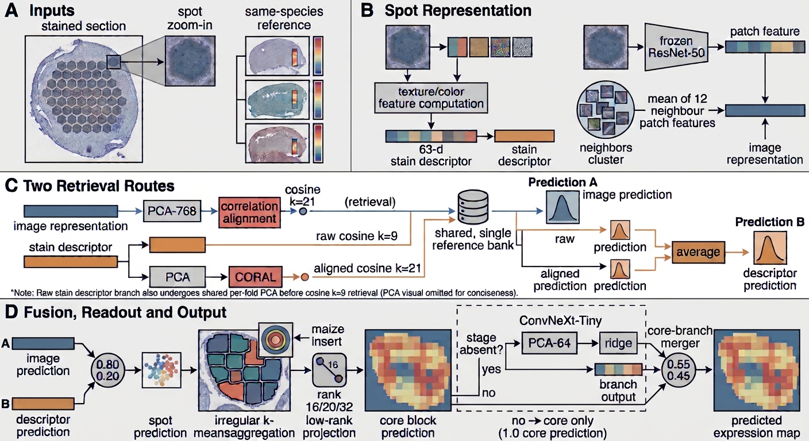

# PlantLumen

Reference-assisted prediction of spatial gene expression from plant histology images.

PlantLumen predicts spatial gene expression from routine plant tissue sections using a same-species
expression reference. It describes each capture location with frozen ImageNet features, the mean of
its 12 nearest physical neighbours and a 63-dimensional plant stain descriptor, retrieves profiled
reference spots explicitly, and projects the retrieved profiles onto a low-rank expression subspace.
The chain is fitted independently within each species and each held-out fold; no weight, reference
bank or gene panel is shared across species.

The method is described in the accompanying manuscript, *PlantLumen predicts spatial gene expression
from plant tissue section images via intraspecies reference retrieval and determines gene image
localizability*.



*PlantLumen prediction chain. A frozen image representation, its 12-neighbour physical context and a
63-dimensional plant stain descriptor query a same-species reference bank; the retrieved expression
profiles are fused at a fixed weight and projected onto a low-rank expression subspace.*

## What is in this repository

| Path | Contents |
|---|---|
| `plantlumen/core.py` | frozen retrieval chain: per-section z-scoring, PCA-768, cosine kNN in a CORAL-aligned space, 0.80/0.20 image–descriptor fusion, rank-16/20/32 projection and the stage-coverage branch |
| `plantlumen/readout.py` | spatial readouts (`spot`, `k8` blocks, `ring` annuli) |
| `plantlumen/run.py` | fold execution and per-gene Pearson scoring |
| `plantlumen/verify.py` | verifies shipped stage-application artefacts |
| `plantlumen/data.py` | cohort bundle format |
| `scripts/` | bundle construction, pathway reporting and demo generation |
| `artefacts/` | shipped per-fold stage-application predictions and the current cohort-level summary tables under `artefacts/summary/` |
| `demo/index.html` | self-contained offline demo of the stage-absent application |
| `tests/` | unit tests and the shipped-artefact check |

The current manuscript's U1 four-cohort analysis pipeline is being consolidated into this package.
The cohort-level summary tables in `artefacts/summary/` are the values reported in the manuscript;
the full per-fold U1 tables will be added in the next release. `artefacts/README.md` records which
files are current and which are legacy 300-gene demonstration data.

## Installation

```bash
git clone https://github.com/StickTaTa/PlantLumen.git
cd PlantLumen
python -m pip install -r requirements.txt
python -m pip install -e .
```

The core retrieval and scoring code needs only NumPy, SciPy and scikit-learn. Feature extraction
from histology images additionally needs PyTorch and torchvision; those are not required for the
shipped artefact checks.

## Quick start

```bash
# Reproduce the shipped stage-application scores from the packaged artefacts
python -m plantlumen verify

# Recompute the stage-absent pathway readout
python scripts/report_s53.py

# Run the chain on a cohort bundle
python -m plantlumen run --bundle bundles/grain --protocol stage --out runs/grain_stage
```

## Data

No raw sequencing data are redistributed in this repository. The four public cohorts used in the
manuscript are:

| Cohort | Species | GEO | Sections | Readout |
|---|---|---|---|---|
| Barley | *Hordeum vulgare* | GSE294392 | 9 | per spot |
| Maize | *Zea mays* | GSE196882 | 7 | within-shoot blocks |
| Arabidopsis | *Arabidopsis thaliana* | GSE320437 | 4 | k = 8 blocks |
| Norway spruce | *Picea abies* | GSE288244 | 88 | per spot |

Raw data, image feature caches and the competitor implementations are not included. They are
available from the original repositories and the authors' official code.

## Current cohort summaries

`artefacts/summary/` contains the cohort-level summaries for the current manuscript:

- `barley_summary.json`
- `maize_summary.json`
- `arabidopsis_summary.json`
- `spruce_bench_summary.tsv`
- `image_r2_cohort_summary.txt`

These are derived tables, not raw data.

## Citation

If you use PlantLumen, please cite the accompanying article. Citation metadata is in
`CITATION.cff`.

## Licence

MIT. See `LICENSE`. Raw GEO data remain under the terms of their original repositories.
